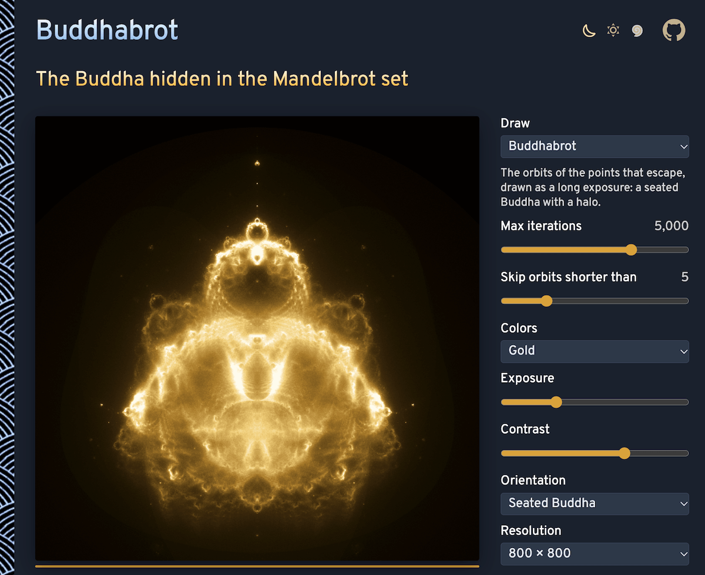

# Buddhabrot

The Buddha hidden in the Mandelbrot set: millions of random points are iterated with z → z² + c, and the paths of those that escape are counted pixel by pixel, like a long-exposure photograph. A seated figure appears, with a head, a halo and folded hands. No sign-up and no libraries.

- [Draw the Buddhabrot](https://evoluteur.github.io/buddhabrot/)

## What it does

- **Buddhabrot**: the orbits of the points that escape, from a soft ghost (20 iterations) to fine filaments (thousands).
- **Nebulabrot**: three Buddhabrots at once with different iteration limits, in red, green and blue, like a Hubble photograph.
- **Anti-Buddhabrot**: the orbits of the points that never escape, the Mandelbrot set itself.
- **Trace an orbit**: move the pointer over the picture to see the path of the point under it, step by step, and whether it escapes.
- Max iterations, a minimum orbit length, seven palettes, **Exposure** and **Contrast**, a seated or a Mandelbrot-like orientation, an outline of the Mandelbrot set, and 800 or 1600 pixels.
- **Pause** and **Download PNG**; the address of the page keeps the settings.

## How it works

As many Web Workers as the processor has cores take random points in the disk of radius 2, skip those inside the main cardioid and the big disk (they never escape), follow the others, and send back the pixels their orbits pass through. Each orbit is drawn twice, mirrored across the real axis. Counts are shown with the white point at a high percentile of the lit pixels, and the drawing stops by itself once the bright parts have collected a few thousand points per pixel, when more would not show.

The Buddhabrot was discovered by Melinda Green in 1993 and named by Lori Gardi.

## Run it locally

No build and no dependencies: open `index.html` in a browser.

## Related projects

- [Mandelbrot and Julia](https://evoluteur.github.io/mandelbrot-julia/)
- [Strange Attractors](https://evoluteur.github.io/strange-attractors/)
- [Apollonian Gasket](https://evoluteur.github.io/apollonian-gasket/)
- [Lightning and Coral](https://evoluteur.github.io/lightning-and-coral/)
- [Flow Fields](https://evoluteur.github.io/flow-fields/)

## License

Had fun browsing the app? [Buy me a coffee by becoming a sponsor](https://github.com/sponsors/evoluteur).

Copyright (c) 2026 [Olivier Giulieri](https://evoluteur.github.io/).

Buddhabrot is released under the [MIT license](https://github.com/evoluteur/buddhabrot/blob/main/LICENSE).
